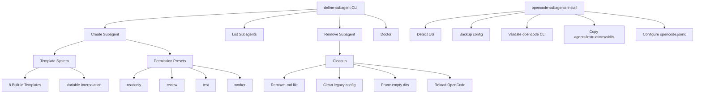

# OpenCode Subagents v2

> Autonomous subagent system for OpenCode v2 — create, invoke, and cleanup specialized AI subagents on-demand.

[](https://www.npmjs.com/package/opencode-subagents)
[](https://nodejs.org/)
[](https://opensource.org/licenses/MIT)

## Overview

OpenCode Subagents v2 is a TypeScript-based CLI tool that enables you to dynamically create, manage, and cleanup specialized AI subagents for OpenCode. Inspired by Claude's subagent system, it allows you to spin up temporary agents for specific tasks (code exploration, testing, documentation, security auditing, etc.) and automatically clean them up when done — leaving zero residue on disk.

## Features

- 🚀 **Dynamic Subagent Creation** — Create specialized agents on-the-fly with custom prompts and permissions
- 📦 **8 Built-in Templates** — Ready-to-use agents for common tasks (API testing, documentation, security, performance, etc.)
- 🔒 **Permission Presets** — `readonly`, `review`, `test`, `worker` for fine-grained control
- 🧹 **Zero-Residue Lifecycle** — Automatic cleanup with `cleanup_command` after task completion
- 🌐 **Cross-Platform** — Works on Windows, macOS, and Linux
- 🌍 **Bilingual** — English and Spanish support
- 🏥 **Health Checks** — Built-in `doctor` command for setup verification
- ⚡ **Dry-Run Mode** — Preview changes before applying
- 🔧 **Unified Installer** — Single command to set up agents, instructions, and skills globally

## Installation

### Quick Install (Recommended)

```bash
npx opencode-subagents@latest install
```

Or install globally:

```bash
npm install -g opencode-subagents
opencode-subagents-install
```

### Manual Install

1. Clone this repository
2. Run `npm install`
3. Run `npm run build`
4. Run `node dist/install.js`

## Quick Start

```bash
# Create a temporary API testing agent
define-subagent --name "my-api-tester" --template api-tester

# The CLI outputs a cleanup_command - save it!
# Example: node define-subagent.js --remove "my-api-tester" --dir ".opencode/agents"

# Invoke the agent in OpenCode
# subagent(agent: "my-api-tester", description: "Tests REST APIs", prompt: "Test the user API endpoints")

# After the agent completes its task, run the cleanup_command
node define-subagent.js --remove "my-api-tester" --dir ".opencode/agents"

# Verify cleanup
define-subagent --list
```

## Templates

| Template | Preset | Description |
|----------|--------|-------------|
| `api-tester` | test | Tests REST/GraphQL APIs, validates contracts, checks error handling |
| `doc-writer` | worker | Writes technical documentation, README files, API docs |
| `security-auditor` | review | Audits code for security vulnerabilities, secrets, compliance |
| `perf-profiler` | readonly | Profiles performance, identifies bottlenecks, suggests optimizations |
| `database-optimizer` | readonly | Analyzes schema, queries, indexes for optimization |
| `dependency-updater` | readonly | Analyzes dependencies for updates, CVEs, breaking changes |
| `migration-helper` | worker | Assists with framework upgrades, language versions, architecture changes |
| `code-migrator` | worker | Performs large-scale code transformations (rename, restructure) |

### Using Templates

```bash
# Create from template (auto-fills description, prompt, preset)
define-subagent --name "my-security-auditor" --template security-auditor

# Override template values
define-subagent --name "custom-auditor" --template security-auditor --description "Focus on auth"
```

### Custom Agents

```bash
# Full custom agent
define-subagent \
  --name "my-custom-agent" \
  --description "Does something specific" \
  --prompt "You are a specialized agent that does X, Y, Z" \
  --preset worker \
  --mode subagent
```

## Permission Presets

| Preset | Edit | Write | Patch | Shell | Use Case |
|--------|------|-------|-------|-------|----------|
| `readonly` | ✗ | ✗ | ✗ | ✗ | Exploration, analysis, reading |
| `review` | ✗ | ✗ | ✗ | ✗ | Code review, security audit |
| `test` | ✗ | ✗ | ✗ | ✓ | Running tests, test diagnosis |
| `worker` | ✓ | ✓ | ✓ | ✓ | Implementation, refactoring |

## Commands

### `define-subagent`

```bash
# Create a subagent
define-subagent --name <name> --description <desc> --prompt <prompt> [options]

# Create from template
define-subagent --name <name> --template <template-name>

# List all subagents
define-subagent --list

# Remove a subagent (with cleanup)
define-subagent --remove <name> --dir <agents-dir>

# Run health checks
define-subagent --doctor

# Dry run (preview)
define-subagent --name test --template api-tester --dry-run

# Force overwrite
define-subagent --name existing --template api-tester --force

# Global scope
define-subagent --name global-agent --template api-tester --global

# Language
define-subagent --lang es --help
```

### `opencode-subagents-install`

```bash
# Install globally (default)
opencode-subagents-install

# Dry run
opencode-subagents-install --dry-run

# Force overwrite
opencode-subagents-install --force
```

## Architecture



## Configuration

The installer creates/updates `~/.config/opencode/opencode.jsonc` with:

```jsonc
{
  "$schema": "https://opencode.ai/config.json",
  "instructions": [
    "{{INSTRUCTIONS_PATH}}/autonomous-subagents.md"
  ],
  "agents": {
    "fast-explorer": { ... },
    "code-reviewer": { ... },
    "test-runner": { ... },
    "code-worker": { ... }
  }
}
```

Use `{{INSTRUCTIONS_PATH}}` placeholder which resolves to:
- Windows: `C:\Users\<user>\.config\opencode\instructions`
- macOS/Linux: `~/.config/opencode/instructions`

## Development

```bash
# Install dependencies
npm install

# Build
npm run build

# Run tests
npm run test

# Lint
npm run lint

# Type check
npm run typecheck

# Format
npm run format

# Watch mode
npm run dev
```

## Project Structure

```
opencode-subagents/
├── src/
│   ├── define-subagent.ts    # Main CLI entry point
│   ├── install.ts            # Unified installer
│   ├── index.ts              # Barrel exports
│   ├── types.ts              # TypeScript interfaces
│   ├── constants.ts          # Constants, presets, messages
│   ├── utils-core.ts         # Core utilities (no deps)
│   ├── utils.ts              # Extended utilities
│   └── templates/
│       └── index.ts          # 8 built-in templates
├── tests/
│   ├── barrel.test.ts        # Barrel export tests
│   ├── define-subagent.test.ts # CLI integration tests
│   ├── install.test.ts       # Installer tests
│   └── integration.test.ts   # Full lifecycle tests
├── agents/                   # Built-in agents (source)
├── instructions/             # Instruction files
├── skills/                   # Skill files
├── dist/                     # Compiled output
├── opencode.example.jsonc    # Example config with placeholders
└── vitest.config.ts          # Test configuration
```

## Lifecycle Management

Subagents created on-the-fly are **temporary** and must be cleaned up:

1. **Create** → Returns `cleanup_command`
2. **Invoke** → Use OpenCode's `subagent` tool
3. **Cleanup** → Run `cleanup_command` immediately after task completion

```
Lifecycle:
  create → invoke → cleanup → --list (empty)
```

The cleanup process:
- Removes the `.md` agent file
- Cleans legacy `agents.<name>` entries from `opencode.jsonc`
- Prunes empty `.opencode/agents` directories
- Reloads OpenCode configuration

## Troubleshooting

### "agent_exists" error
```bash
# A file with this name already exists. If it's a leftover temporary agent:
node define-subagent.js --remove "agent-name" --dir ".opencode/agents"

# Then retry with --force
define-subagent --name "agent-name" --template api-tester --force
```

### "OpenCode CLI not found"
```bash
# Install OpenCode from https://opencode.ai
# Verify with: opencode --version
```

### Doctor shows "degraded" or "unhealthy"
```bash
# Run doctor for details
define-subagent --doctor

# Common fixes:
# - Install OpenCode CLI
# - Run installer: opencode-subagents-install
# - Check global config directory permissions
```

## Contributing

See [CONTRIBUTING.md](CONTRIBUTING.md) for guidelines on:
- Adding new templates
- Code style
- Testing
- Pull request process

## License

MIT License - see [LICENSE](LICENSE) for details.

## Related

- [OpenCode](https://opencode.ai) - The AI coding agent
- [Superpowers](https://github.com/opencode-ai/superpowers) - Skills and workflows for OpenCode